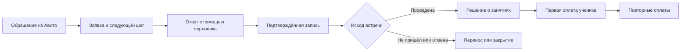

# ТЗ Cantor: первая рабочая версия сервиса

Редакция: 16.11.2026. Статус: рабочее ТЗ; основные продуктовые решения согласованы владельцем в чате.

**Основание:** [полный документ владельца](https://drive.google.com/file/d/1VwLj9B56S5FGLnq3ALuiIRMrkmBrOJ2z/view), [разбор и проверка кода](product-review.md). Концепция, шесть разделов, три формата обслуживания и целевая автоматизация взяты из источника. Детальные правила данных, приёмки и предложенное разделение релизов ниже — новая редакция, а не уже утверждённые бизнес-решения.

## Согласованные решения владельца · 16.11.2026

Эти решения получены в чате и заменяют противоречащие им предложения предыдущих редакций.

- **Пилот:** текущие клиенты агентства и несколько самостоятельных репетиторов; один кабинет Авито на клиента. Конкретные участники пока не определены и выбираются позже, это не блокирует разработку.
- **Цены:** конструктор от 1 990 ₽/мес, «Всё включено» 9 990 ₽/мес, премиум 25 000 ₽/мес; первый месяц премиума 50 000 ₽. Цены утверждены.
- **Начало доступа:** сразу платно, без бесплатного аудита и бесплатного триала.
- **Подписка:** месяц с даты оплаты, с автоматическим продлением. Отдельной заморозки нет: клиент отключает продление и пользуется до конца оплаченного периода, а не до конца календарного месяца.
- **Возврат:** стоимость неиспользованного периода, только по запросу администратору. Автоматической кнопки возврата и самостоятельного запуска возврата клиентом нет.
- **После окончания подписки:** вся сохранённая история остаётся доступна; новые данные не подтягиваются. Это явно написано в интерфейсе; старые данные не выдаются за свежие.
- **«Всё включено»:** без лимитов; не вводить скрытые квоты, ограничения «разумного использования» или доплаты за превышение.
- **Куратор:** может консультировать и выполнять любые задачи по работе в сервисе. **Премиум:** полное ведение, клиент вообще ни о чём не думает; команда сама организует и контролирует работу.
- **Поддержка Cantor:** живые кураторы и живая команда, 10:00–18:00 МСК. Общение в Telegram-чате; ИИ к ответам поддержки сейчас не подключается. Встроенный чат — позднее развитие. Рабочие дни и нормативы берутся из действующей базы знаний, новые условия не выдумываются.
- **Ответы в Авито:** три настраиваемых режима — ручные, ИИ по согласованию, ИИ автоматически. По умолчанию при первом подключении **всегда ручной**. Это отдельный контур от поддержки Cantor.
- **Масштаб настройки:** режим всего кабинета с исключениями отдельных диалогов. Если человек вмешался в автоматический диалог, этот диалог переключается на **ИИ по согласованию**, а не на ручной режим или неопределённую паузу.
- **Сценарий продажи:** максимально быстро доводить до встречи/диагностики, избегать обсуждения цены и подробного формата до созвона. Действующая методика и персональная база знаний служат основанием; прямое уточнение владельца имеет приоритет при противоречии старому тексту.
- **Расписание:** собственное в Cantor, без синхронизации с внешними календарями на текущем этапе.
- **Автоматическая запись:** допустима только по настройке преподавателя и в реально доступное окно.
- **Напоминания и повторные касания:** по существующей базе знаний, не по придуманной заново схеме. Источники и правила сведены в [dialog-policy.md](dialog-policy.md).
- **Ставки, объявления и бюджет:** клиент настраивает самостоятельно, сервис даёт подсказки и рекомендации. Куратор может помогать; на премиуме настройку берёт команда. Автономные изменения от рекомендаций не запускаются.
- **Аналитика:** базовые показатели Авито, учёт диагностик/оплат и общая стоимость ученика входят в базу; подробная атрибуция по объявлениям/городам и разбор качества диалогов — дополнительные модули.
- **Ранний доступ:** год за 49 900 ₽, включено всё максимально — все предусмотренные модули и сопровождение. Не подменять предложение ограниченным набором опций.
- **Вопросы:** действительно новые продуктовые решения задаются владельцу в чате. Сначала проверяются ТЗ, база знаний и уже полученные ответы. Повторно согласовывать утверждённые правила не нужно; технические решения принимает разработчик.

## Уточнение интерфейса владельцем · 16.11.2026

Убрать дублирующие заголовки и вводные подписи, хлебные крошки, все примечания о демо, футер и тёмную тему. Только светлый интерфейс; эти элементы не возвращать в следующих проходах. Техническая изоляция превью и отсутствие реальных подключений остаются в документации/метаданных, без постоянных плашек в продукте.

## 1. Цель и границы

Cantor помогает репетитору получать учеников с Авито и управлять путём от обращения до оплаты. Команда ведения работает в тех же карточках и видит те же результаты, что клиент, с дополнительными правами.

Первый рабочий релиз **R1 — пилот на текущих клиентах и нескольких самостоятельных репетиторах**: личный доступ, данные своего кабинета, очередь обращений, три режима ответов, запись, исход диагностики, учёт оплаты. Система должна сохранять всю эту цепочку на сервере и объяснять цифры дашборда.

Следующий релиз **R2 — массовое самостоятельное подключение**: проверенный OAuth Авито, импорт, самостоятельный выбор тарифа и прав модулей, онбординг без помощи разработчика; клиентские операции с объявлениями и ставками после проверки интеграций.

**R3 — расширение автоматизации**: календарная интеграция, напоминания и отдельные режимы автопилота. Отправка сообщений в трёх режимах относится к R1. Состав R3 из полного ТЗ сохраняется в бэклоге; его наличие не требуется выдавать за готовность R1.

В R1 не входят: массовая генерация и публикация объявлений, самостоятельная закупка продвижения, автоматические рассылки/скидки, звонки с расшифровкой, автоматические отзывы/жалобы, миграция всех внутренних инструментов агентства.

Состав пилота, три режима ответов и цены согласованы владельцем. Остальное разделение работ по релизам остаётся предложением очередности; полный объём источника не отменяется.

## 2. Пользователи, права, ответственность

| Роль | Что делает | Ограничение |
| --- | --- | --- |
| Владелец клиентского пространства | Подключает кабинет, задаёт сведения и окна, ведёт обращения, фиксирует диагностики и оплаты | Только свои данные; управление участниками и тарифом — у владельца |
| Назначенный специалист/куратор | Работает с разрешёнными клиентами, отвечает за следующий шаг, консультирует и выполняет любые задачи по работе в сервисе | Нет доступа к другим клиентам и глобальным ключам моделей; отзыв назначения прекращает доступ |
| Администратор платформы | Управляет подключением, ролями, поддержкой и доступностью модулей | Административные действия журналируются; отдельный интерфейс от клиентского кабинета |
| ИИ-помощник | По режиму кабинета не участвует, готовит ответ человеку либо отвечает автоматически; предлагает следующий шаг и предварительный этап | Не выходит за выбранный режим; оплата требует отдельного подтверждения, запись — проверки доступности |

Пространство — граница владения данными. В R1 один рабочий кабинет Авито на пространство; дальнейшее расширение на несколько кабинетов не должно менять идентификаторы заявок и учеников. Один пользователь может состоять в нескольких пространствах. Привязку действующего кабинета к пространству выполняет администратор после проверки владельца; произвольный `accountId` от клиента не даёт доступа.

Вход в Cantor и разрешение доступа к Авито — разные операции. Подключение Авито не заменяет проверку прав на пространство.

## 3. Первый запуск

### 3.1. Пилот R1

1. Администратор приглашает текущего клиента или самостоятельного участника пилота, создаёт пространство, назначает владельца и при необходимости специалиста. Существующий кабинет привязывается после проверки владельца; самостоятельному участнику помогают подключить его кабинет. Отсутствие платного ведения не закрывает ему основной сценарий сервиса.
2. Владелец входит по личному приглашению и видит название своего кабинета. Общий пароль дашборда ему не выдаётся.
3. Заполняет предмет, классы, формат, длительность/цену занятий, предложение диагностики, часовой пояс, контакты и правила общения.
4. Задаёт свободные окна. Обязательные поля для черновиков — факты о преподавателе и условия; без них ИИ задаёт уточнения человеку.
5. Синхронизация показывает состояние каждого источника и доступную глубину истории. Клиент видит реальные данные либо понятное состояние ожидания/ошибки.
6. При первом подключении установлен ручной режим ответов. Владелец может явно выбрать ИИ по согласованию или автоматический режим; изменения сохраняются, режим виден в рабочем интерфейсе. Для отдельного диалога доступно исключение из общего режима.
7. Первая рекомендация открывает конкретный объект с нужным действием. Если обращений нет, предлагается подготовить профиль и окна, а не показываются вымышленные лиды.

### 3.2. Самостоятельный запуск R2

Платный самостоятельный запуск: регистрация → выбор тарифа и подтверждение оплаты → разрешение доступа Авито → проверка полученного кабинета/прав → импорт → анкета и окна → первая полезная задача. Бесплатного аудита и пробного доступа нет. Технические ошибки подключения после оплаты обрабатываются поддержкой и согласованной политикой возврата.

OAuth сначала проходит техническую проверку: права приложения, разрешения клиента, получение профиля, обновление и отзыв токена. До этого «кнопка подключения без ключей» — требование, а не реализованный факт. При отказе в разрешении пользователь возвращается в мастер с объяснением и может повторить шаг без нового пространства.

Импорт существующего фида и объявлений, созданных вручную, — разные сценарии. Сервис не обещает восстановить отсутствующие тексты/фото из статистического API. Смена источника автозагрузки требует просмотра последствий; существующий фид нельзя молча перезаписать.

Владелец утвердил оплату с самого начала. 14-дневный триал и бесплатный предварительный аудит не предоставляются. Подписка действует месяц с даты оплаты и продлевается автоматически; отключение продления сохраняет доступ до конца оплаченного периода. Возврат неиспользованного периода обрабатывает администратор по запросу. Время «15 минут» проверяется замерами на пилоте; длительность обработки источников показывается отдельно.

## 4. Основной рабочий сценарий

Отказ, нецелевое обращение и переход в другой мессенджер фиксируются отдельно и не удаляют историю. Ученик может оплатить без диагностики; такая продажа допустима, но не создаёт фиктивную проведённую встречу.

В R1 действуют три согласованных режима:

| Режим | Подготовка ответа | Отправка |
| --- | --- | --- |
| Ручные ответы | Человек пишет текст | По явному действию человека |
| ИИ по согласованию | ИИ готовит черновик; человек может исправить или отклонить | После явного подтверждения человеком конкретной версии ответа |
| ИИ автоматически | ИИ готовит и проверяет ответ по базе и истории | Без согласования каждого сообщения, в рамках включённого режима; при неопределённости — задача человеку |

Копирование, оценка и одобрение черновика не равны доставке сообщения. В интерфейсе раздельны проверка текста и команда отправки. Результат отправки подтверждается внешней интеграцией и сверкой истории. При недоступном методе отправки режим обозначается недоступным; подменять его имитацией нельзя. Согласован общий режим кабинета с исключениями для отдельных диалогов. В диалоге показаны эффективный режим и его источник: «настройка кабинета» либо «исключение». Доступно явное возвращение к наследованию режима кабинета. Согласованное правило вмешательства: ручной ответ человека в автоматическом диалоге создаёт исключение `ai_approval` для этого диалога. Дальнейшие ответы ИИ требуют подтверждения; общий режим кабинета не меняется. Задание на автоматическую отправку перед исполнением повторно проверяет эффективный режим и после вмешательства человека без подтверждения не отправляется.

## 5. Требования к шести разделам

### 5.1. Дашборд

- Период: сегодня, 7 дней, текущий месяц, произвольные даты; часовой пояс указан. Период передаётся в аналитику при переходе.
- Верхний уровень: расходы на Авито, новые обращения, проведённые диагностики, новые оплатившие ученики, доступные показатели стоимости. Выручка и расходы имеют подписи состава.
- Две связанные области: статистика продвижения и CRM-путь людей. Не соединять их ложной сквозной конверсией при отсутствии идентификации.
- Три приоритетных действия и доступ ко всем остальным. Каждое содержит факт, источник, объект, срок/время ожидания, ответственного и целевое действие.
- Здоровье подключения: когда обновились данные, что не загрузилось, где требуется доступ или действие в Авито.
- Если данных нет, показать причину. Ноль — только достоверно полученное нулевое значение. Демонстрационный контур технически отделён от рабочего. По прямому указанию владельца от 16.11.2026 плашки и примечания о демо в интерфейсе удалены.

### 5.2. Аналитика

- Срезы по периоду, объявлению и городу только при наличии соответствующих исходных данных. Город объявления не равен географии каждого обратившегося.
- Показатели Авито: показы, просмотры, контакты, избранное, расходы — с названиями метрик исходного API и единицами. Отсутствующие поля показываются как недоступные.
- CRM: новые заявки, записанные, проведённые диагностики, отмены/неявки, новые ученики, оплаты, возвраты, неатрибутированные результаты.
- Для каждого числа доступно объяснение расчёта; для CRM — список объектов, из которых оно получено.
- 10–12% просмотра в контакт — ориентир из методики источника, не гарантия площадки. Вывод «ниже ориентира» показывает размер выборки и период. Минимальная выборка для рекомендаций — отдельная настраиваемая политика, до её выбора вывод считается наблюдением.
- Базовые показатели Авито, учёт диагностик/оплат и общая стоимость ученика доступны в базовом тарифе. Подробная атрибуция по объявлениям/городам и разбор качества диалогов — дополнительные модули; «Всё включено» и ранний доступ включают их.
- Конверсии людей считаются по когорте поступления заявок с датой среза; текущая активность периода показывается отдельно. Заявка октября с оплатой ноября не становится новой заявкой ноября.
- До появления достаточной выборки не показывать «потери в рублях» и сравнение с нишей как измеренный факт.

**Будущее · решение владельца 20.11.2026, без UI в этой итерации:** выбор исторических объявлений и их сравнение в «Аналитике», включая архивные за выбранный период. Нужны идентичность объявления, сохранённые версии и покрытие источника; отсутствие истории не заменять нулями.

### 5.3. Мои объявления

R1: список доступных объявлений, ID, реальный статус, город, показатели за выбранный период, ошибки источника и ссылка в Авито. Из проблемного объекта можно перейти к рекомендации и ответственному.

**Реализовано 20.11.2026:** при выборе двух и более объявлений в списке доступно «Сравнить»: доступный диалог с прокручиваемой таблицей, показы/просмотры/контакты/расходы, конверсии с формулами и CPL. Указаны единый период списка, источник и объём выборки. Ноль отличается от отсутствия данных, деление на ноль не выполняется. Ставка и дневной бюджет — контекст сохранённого среза, не история периода; дни платного продвижения без подтверждения не рассчитываются. Изменения в Авито не отправляются.

**Будущее · решение владельца 20.11.2026, без UI в этой итерации:** отдельный журнал изменений объявлений рядом с историей/логами автозагрузки. Фиксировать фото, заголовок/текст, цену, ставки, бюджет, расписание и прочие изменения: объявление, время, автор/источник, старое и новое значение, статус подтверждения применения. Не смешивать редактирование с успешной публикацией и не восстанавливать историю из текущего снимка. Нужна защищённая история версий; существующие локальные записи действий ею не являются.

R2: мастер «модель → текст → фото → города → предпросмотр → публикация», импорт управляемого фида, журнал версий и отчёт выгрузки. Предварительная проверка полей идёт по актуальным требованиям категории Авито. Десять фото — ориентир контента; обязательность конкретных слотов требует отдельного решения, а не определяется произвольным названием файла.

Публикация — асинхронная операция: «подготовлено», «отправлено», «обрабатывается», «размещено», «отклонено», «ошибка». Запись фида не равна успешной публикации. Повтор операции не создаёт копию объявления.

Клиент сам задаёт ставки, расписание и бюджет; рекомендации не являются командами на изменение. На премиуме эти действия выполняет команда, куратор может выполнять их для назначенного клиента. Ставки R2: до изменения показываются кабинет, объявления, текущие и предлагаемые значения, расписание, лимиты. После изменения различаются «сохранено», «в очереди», «применено», «ошибка». Прогноз не выдаётся за гарантированное место. Пользователь может остановить наш менеджер ставок; смысл остановки и возвращаемая ставка явно описаны.

### 5.4. Мои диалоги

- Представления «Чаты» и «Воронка» работают с одними заявками. Фильтры: ждут ответа, есть черновик, требуется человек, записаны, после диагностики, отказ/нецелевые.
- Карточка: участник, исходное объявление, история сообщений, текущий этап, ответственный, следующий шаг, задачи, записи, ученик и оплаты.
- Этап можно исправить вручную; сохраняются старое значение, новое, автор, время и причина. ИИ предлагает этап, не переписывает ручное решение молча.
- Черновик учитывает факты преподавателя, историю, правила общения и реальные окна. Нельзя выдумывать цену, скидку, результаты учеников, доступность или ссылку встречи.
- Действия: написать вручную, редактировать, отправить, скопировать, оценить, не отвечать, передать человеку. Доступность и необходимость подтверждения определяются выбранным режимом. Ошибка генерации не блокирует ручную работу.
- При новом входящем сообщении черновик помечается устаревшим. Недоступное голосовое/вложение не трактуется как отсутствие важного содержания.
- «Записать» требует выбрать заявку, окно, длительность и участника. Запись, перенос, отмена и исход встречи — самостоятельные события.
- Первая оплата создаёт нового оплатившего ученика один раз. Следующие платежи увеличивают сумму, сохраняя прежнее число новых учеников.

### 5.5. База знаний

Разделить два типа информации: общая методика Cantor и факты конкретного преподавателя. Общий урок не подменяет персональный прайс, расписание и договорённости.

R1: редактируемая анкета/база фактов преподавателя, правила общения, сведения об источнике и обновлении; приоритет — запись на диагностику, а не подробное обсуждение цены и формата; практические материалы со ссылкой из нужного сценария. Устаревшие и неподтверждённые факты не используются ИИ как достоверные.

R2: курсы, видео и прогресс. Чат по базе знаний и генерация материалов — отдельные возможности, зависящие от состава тарифа. В «Всё включено» и раннем доступе все предусмотренные модули доступны без лимитов. ИИ-чату не передаётся роль живой поддержки на текущем этапе.

### 5.6. Настройки

Три отдельные группы: профиль и участники Cantor; подключение и состояние Авито; подписка Cantor и состав модулей.

Подписка Авито, кошелёк/аванс Авито и оплата Cantor — разные сущности. Нельзя показывать их одним тарифом. При недоступном авансе не выводить расчёт «хватит на N дней» из кошелька другого типа. Цена размещения не фиксируется универсальными 100 ₽/день: существующее внутреннее правило нужно сверить с конкретным тарифом и составом расходов.

Права на модули следуют оплаченному тарифу; в пилоте администратор может подтвердить фактически полученную оплату, но интерфейс не имитирует банковское списание. Перед оплатой видны итоговая цена, срок, состав, автоматическое продление и условия возврата. «Всё включено» без лимитов. Понижение тарифа и окончание подписки не удаляют историю.

### 5.6.1. Подписка Cantor и окончание оплаченного периода

- Оплаченный период — один календарный месяц с даты оплаты. Пограничные даты обрабатываются последовательно: если соответствующего дня в следующем месяце нет, конец периода — последний день этого месяца; исходная дата продления сохраняется, чтобы график не сдвигался навсегда после февраля.
- В настройках показаны оплачено до, сумма и дата следующего продления, состояние автопродления. Автопродление реализуется реальной платёжной интеграцией; одна повторная доставка уведомления об оплате не создаёт второе списание или лишний месяц доступа.
- Действие клиента «Отключить продление» отменяет следующее продление, не отнимая уже оплаченное время. Отдельной функции заморозки, остановки счётчика дней и переноса остатка нет.
- Клиент запрашивает возврат у администратора в Telegram. В интерфейсе можно дать контакт администратора, но не кнопку автоматического возврата. Администратор фиксирует основание, неиспользованную часть фактического оплаченного периода, рассчитанную сумму и результат. Не вводить неутверждённое невозвратное удержание за настройку.
- При окончании периода сохранённая история, отчёты, объявления, диалоги, записи и оплаты остаются доступными. Все новые подтягивания данных прекращаются, включая фоновые задания, ручное обновление и входящие события интеграции. Повторный вход не запускает обновление в обход оплаты.
- Обязательный текст состояния: **«Подписка закончилась. Вся сохранённая история доступна. Новые данные из Авито не загружаются. Последнее обновление: …»** Рядом — возможность продлить подписку. Новую информацию не подменять нулями; возраст сохранённых данных виден в каждом соответствующем отчёте.
- После подтверждённого продления синхронизация возобновляется с защитой от дублей. История до окончания и после возобновления относится к тому же пространству.
- Ранний доступ: год за 49 900 ₽, включены все предусмотренные модули и сопровождение. Годовой период не заменяется месячным, полное включение не заменяется выборочным набором.

### 5.6.2. Живая команда и Telegram

Рабочий канал клиента с куратором/командой — Telegram-чат. Часы — 10:00–18:00 МСК; действующий регламент команды задаёт будни и ответ клиенту до 30 рабочих минут ([регламент задач](../../base/reglament-task-treker#t15)). Это норматив команды, а не выдуманный ранее двухчасовой срок. Куратор может выполнять задачи; премиум освобождает клиента от необходимости организовывать работу. Сейчас в поддержку не добавляется ИИ-ответчик. Встроенное окно чата — последующий этап, не обязательная часть пилота.

## 6. Модель данных и инварианты

Все сущности принадлежат `workspaceId`; права проверяются сервером на чтение и запись, включая фоновые задания и выгрузки. Имена используются для отображения, а не как ключи.

| Сущность | Минимальные поля/связи | Инвариант |
| --- | --- | --- |
| Membership | userId, workspaceId, role, status | Отзыв прав действует на сервере, а не только прячет меню |
| Subscription / Entitlement | workspaceId, тариф, начало/конец периода, исходная дата продления, autoRenew, оплаченные модули, внешний платёж | Подписка Cantor отделена от оплат учеников и тарифа Авито; после окончания история доступна, синхронизации нет |
| AvitoConnection | workspaceId, внешний userId, разрешения, статус, последний успешный sync | Секреты и токены доступны только серверной интеграции |
| Listing / ListingMetric | connectionId, внешний itemId, дата, город, метрики и источник | Повтор синхронизации обновляет запись по внешнему ключу |
| Lead / Conversation | leadId, внешний chatId, listingId либо неизвестный источник, этап, ответственный | Разные люди с одинаковым именем не объединяются; несколько заявок одного человека объединяются только явно |
| Message / Draft | внешний messageId, направление, время; версия истории и базы для черновика | Повтор события не дублирует сообщение; новый контекст делает черновик устаревшим |
| Student | studentId, leadId, имя участника, связь с плательщиком | Родитель и ученик не обязаны быть одним человеком |
| Appointment | leadId, startsAt, endsAt, timezone, status, результат, версия | Нельзя подтвердить пересекающиеся записи одного преподавателя |
| Payment | studentId, leadId при наличии, amountMinor, currency, paidAt, статус, ключ повтора | Повтор отправки не создаёт второй платёж; возврат связан с исходным платежом |
| Task | объект, тип, приоритет, dueAt, assigneeId, status, deduplicationKey | Одна причина не создаёт новую задачу на каждом обновлении |
| AuditEvent / IntegrationJob | актор, объект, операция, результат, временные метки, requestId | Можно восстановить, кто и что изменил; журнал не содержит секреты |

Оплаты — учёт реально полученных преподавателем денег, не банковский эквайринг. Сумма положительная, в минимальных денежных единицах, валюта обязательна. Исправление и возврат оставляют след, а не удаляют историю. Частичный возврат уменьшает чистую сумму; полный возврат убирает ученика из показателя действующих первых оплат, с объяснимым пересчётом. Историческое событие первой оплаты сохраняется для аудита.

Конкурентная запись двух людей в одно окно: один успешный результат, второму — конфликт и обновлённая доступность. Нужны транзакция/атомарная проверка или эквивалентная гарантия. Проверка только в браузере и обычная запись JSON без согласования этого не обеспечивают.

## 7. Словарь показателей

| Показатель | Расчёт | Ограничение |
| --- | --- | --- |
| Контакты Авито | Значение выбранной метрики API по объявлению и периоду | Даже дневные `uniqContacts` при суммировании не становятся уникальными людьми за месяц/все объявления |
| Новые заявки | Уникальные leadId, созданные за период | Не равны контактам API; часть звонков и переходов не сопоставлена |
| Проведённые диагностики | Встречи со статусом `completed` по фактическому времени проведения | Записан, отменён, не пришёл — не проведён |
| Новые оплатившие ученики | studentId с первой действующей оплатой в периоде | Повторные платежи не дают новых учеников |
| Получено оплат | Сумма платежей по paidAt | Отдельно сумма возвратов и чистые поступления |
| Цена контакта | Подтверждённые расходы Авито / контакты того же периода и охвата | Нет расходов или знаменатель 0 → «не рассчитано», не 0 ₽ |
| Расходы на нового ученика за период | Расходы Авито периода / новые ученики периода | Периодный показатель, не точная сквозная стоимость привлечения когорты |
| Конверсия заявки в диагностику | Уникальные заявки когорты с проведённой встречей / заявки когорты | Показывать дату среза; одна заявка с двумя встречами считается один раз |
| Конверсия диагностики в первую оплату | Заявки той же когорты с проведённой встречей и первой оплатой / заявки с проведённой встречей | Прямые продажи без диагностики показывать отдельно |

Расходы Авито разделяются по подтверждённым типам: продвижение, размещение и прочие услуги; состав `allSpending` проверяется, чтобы не прибавлять размещение дважды. Подписка Cantor показывается отдельно; «полная стоимость привлечения» имеет явную формулу распределения. Без данных о марже и длительности обучения не обещать достоверную окупаемость.

Сквозной отчёт связывает заявку с исходным объявлением при наличии внешней связи. Если её нет, результат остаётся в «источник не определён», без пропорционального распределения на объявления. Стоимость по когорте требует сопоставимого источника расходов и оговорённой методики атрибуции; пока его нет, доступен периодный показатель с честным названием.

Технически хранить время событий в UTC, отображать в часовом поясе пространства (по умолчанию Europe/Moscow). Границы отчётного дня формируются в этом поясе. Интервал отчёта на сервере полуоткрытый `[from, to)`; адаптер переводит его в правила дат конкретного API. Денежные единицы Авито переводятся явно в одном адаптере.

## 8. Очередь действий и правила

Предложение приоритета: потеря доступа/блокировка → ожидающий ответа человек → приближающаяся встреча → задача после диагностики → оптимизация объявления. При равном приоритете — ближайший срок и длительность ожидания.

Каждое правило имеет идентификатор, версию, основание и условие завершения. Задача по ответу закрывается подтверждённым исходящим сообщением, по диагностике — отмеченным исходом, по оплате — внесённой оплатой либо ручным исходом «не купил». Переход по ссылке задачу не закрывает. Счётчик раздела — число уникальных открытых задач, а не сумма повторяющихся симптомов.

Скорость ответа, повторные касания, приглашение на диагностику и напоминания берутся из [dialog-policy.md](dialog-policy.md), сверенного с действующей базой знаний. Норма первого ответа — 15–30 минут в применимые часы, это методика работы, не SLA Авито. Прежние предложения «одно сообщение через сутки» и универсальное напоминание «за 3 часа» не применяются.

На текущем этапе напоминания формируют задачи человеку. Отправка покупателю в дальнейшем следует выбранному режиму: ручной, с подтверждением или автоматический. Перенос/отмена встречи отменяет старое напоминание. Отказ закрывает дальнейшие повторные касания. Просроченная встреча требует отмеченного исхода, а не автоматической отметки «проведено».

## 9. Интеграции и серверный контракт

### 9.1. Повторное использование

Использовать существующие возможности Worker и Yandex-прокси как исходную инфраструктуру. Из `service-shell` можно сохранить компоненты и навигацию; адаптеры данных и предметная модель заменяют прямой импорт `sample` и localStorage. Сам факт наличия кода авторизации в шаблоне не решает права на кабинеты Worker.

| Контур сейчас | Повторное использование | Обязательная доработка |
| --- | --- | --- |
| `/api/avito/overview`, `/chats`, `/messages`, `/tariff` | Серверные функции чтения | Ограничить кабинетом клиента; не отдавать список всех кабинетов |
| `/api/dashboard/ai-sales/*` | История, черновики, обратная связь, база | Изолировать конфигурацию, задания и обучающие примеры по пространству; убрать персональные значения по умолчанию другого преподавателя |
| `/api/dashboard/mbids/*` | Механика ставок, очередь, метрики | Проверить полномочия на каждый кабинет/объект; не передавать глобальное состояние клиенту |
| `/api/dashboard/feeds*`, `/api/avito/autoload` | Фиды и отчёты | Связать с правами пространства и журналом публикации |
| Yandex-прокси | Транспорт, уже используемый командой | Проверить передачу пользовательского удостоверения, CORS, cookies/заголовков и всех новых маршрутов |

Текущий прокси пропускает `/api/dashboard/*`, а не произвольный `/api/avito/*`. Предложенное пространство маршрутов клиента — `/api/dashboard/service/*` с **собственной** проверкой личной сессии и прав; оно регистрируется раньше общего обработчика дашборда. Это новый контракт, пока не существующий API. Альтернатива требует явного изменения маршрутизации прокси.

### 9.2. Предлагаемые операции R1

| Операция | Результат |
| --- | --- |
| `GET /me`, `/bootstrap` | Пользователь, доступные пространства, выбранное пространство, разрешения и состояние источников |
| `GET /overview`, `/analytics` | Данные периода, состав метрик, степень полноты, временные метки источников |
| `GET /tasks`, `/leads`, `/leads/:id` | Очередь, фильтрованные заявки, конкретная карточка и история |
| `POST /leads/:id/stage`, `/leads/:id/drafts` | Версионированная смена этапа или асинхронное задание генерации |
| `PUT /reply-settings`, `/leads/:id/reply-settings`; `POST /leads/:id/messages` | Режим кабинета и исключение диалога с возможностью возврата к наследованию; ручная или подтверждённая отправка конкретного текста с защитой от повтора |
| `GET /availability`; `POST /appointments`, `/appointments/:id/reschedule`, `/appointments/:id/outcome` | Доступность, атомарная запись, перенос, отмена или исход |
| `GET /payments`; `POST /payments`, `/payments/:id/refunds` | Учёт платежей и возвратов с ключом повторной операции |
| `GET /knowledge`; `PUT /knowledge` | Факты преподавателя и новая версия базы |
| `GET /jobs/:id`; `POST /sync` | Статус своей фоновой операции; явный запуск синхронизации с ограничением частоты, только при действующей подписке |
| `GET /subscription`; `PUT /subscription/renewal` | Период, состав тарифа и настройка автопродления; без клиентского метода автоматического возврата |

Пути в таблице относительны к `/api/dashboard/service`. Каждая операция выбирает пространство из проверенного контекста, а не доверяет присланному клиентом accountId. Для намеренно выбранного workspaceId сервер проверяет членство.

Ответы содержат `requestId`, `data` либо структурированную ошибку; для данных — `source`, `syncedAt`, `status` (`ready`, `partial`, `stale`, `unavailable`) по источнику. Для записей — `version`, для заданий — `jobId` и состояние. Нет сессии → 401; нет прав → 403 либо единообразный 404 для чужого объекта; конфликт записи/версии → 409; ошибка полей → 422; недоступность источника → отдельная ошибка интеграции с возможностью повтора.

### 9.3. Проверки до обещаний автоматизации

Таблица «есть в API» полного ТЗ — перечень заявленных возможностей, а не доказательство их доступности конкретному приложению Cantor. До реализации проверить актуальные методы, scopes, допуски приложения, тарифные ограничения, лимиты и реальные ответы для OAuth, messenger/webhook, календаря, autoload, статистики расходов, special-offers, отзывов и CPA-жалоб.

События вебхука и опроса дедуплицируются. Опрос остаётся способом сверки пропущенных событий; длительная генерация/синхронизация не держит HTTP-запрос открытым до таймаута. Повторы чтения допустимы с задержкой; внешние записи требуют защиты от повторной отправки. Платформа не начинает диалог с новым покупателем через несуществующий метод.

В R1 режим ответов хранится отдельно от технического состояния обработки. Режимы: `manual`, `ai_approval`, `ai_auto`; технические состояния: работает, приостановлен, ошибка интеграции. Включение автоматического режима — явная настройка пользователя, а не условие отдельного позднего релиза. Эффективный режим определяется исключением диалога, а при его отсутствии — настройкой кабинета. Перед отправкой перепроверяются версия истории, актуальность окна, эффективный режим и отсутствие ответа человека. По умолчанию выбран `manual`; вмешательство человека в `ai_auto` меняет исключение этого диалога на `ai_approval`. При неизвестном факте/ошибке задача передаётся человеку. Событие «внешняя отправка подтверждена» отличается от «команда принята».

## 10. Надёжность, доступ и интерфейс

- Статистика и операционные данные хранятся на сервере. localStorage допустим для предпочтений интерфейса и отдельного демо, не для подтверждённых оплат/записей.
- Секреты Авито, общий пароль агентства и глобальные ключи моделей не попадают в клиентский код, URL, логи и ответы API. Клиентские объекты нельзя получать подбором ID.
- Не создавать новую транзакционную CRM обычным перезаписыванием общей KV-записи без механизма конфликтов. Перед реализацией выбрать и документировать серверное хранилище и способ атомарных операций; не переносить инфраструктуру автоматически вслед за шаблоном Grok.
- Частичная ошибка не стирает последние успешные данные. Старые данные подписаны; повтор синхронизации не создаёт новые заявки и оплаты.
- Состояния каждого экрана: загрузка, данные, пусто, частично, ошибка, нет доступа, отключённый модуль. Текст сообщает следующее доступное действие.
- Ширины проверки: 390 и 1440 px, клавиатурный доступ, видимый фокус, подписи полей, ошибки рядом с полем, статус не только цветом. Мобильные чаты открывают одну рабочую область; таблицы имеют собственный скролл, страница не расползается.
- Начальная цель пилота: обзор из сохранённого состояния до 2 секунд на согласованном тестовом наборе; внешняя синхронизация показывает прогресс отдельно. Объём набора и частота обновления фиксируются перед нагрузочной проверкой.
- Поддержка видит ошибки по requestId без доступа к чужим данным по умолчанию. Резервирование и проверка восстановления обязательны до платного запуска; сохранённая история остаётся доступной после окончания подписки, а новые данные не подтягиваются. Окончание подписки не является командой удаления пространства.

## 11. Критерии приёмки R1

| ID | Сценарий | Проверяемый результат |
| --- | --- | --- |
| AC-01 | Два клиента и назначенный одному специалист | Через UI и прямой запрос клиент/специалист не читают чужие заявки, задания, платежи и кабинет |
| AC-02 | Первое подключение, нулевая статистика, ошибка Авито | Три разных состояния; демоданные не подмешиваются в рабочие |
| AC-03 | Одно сообщение пришло через опрос и повторно через событие | Одно сообщение и одна заявка; история не удваивается |
| AC-04 | Преподаватель скопировал черновик | Отправка не отмечена; задача закрывается только после подтверждения либо явного ручного исхода |
| AC-05 | После генерации пришло новое сообщение | Старый черновик явно устарел; подтверждение записи не выполняется из старого контекста |
| AC-06 | Два оператора одновременно бронируют пересекающиеся окна | Одна подтверждённая запись, второму понятный конфликт; после перезагрузки результат тот же |
| AC-07 | Встречу перенесли, затем отметили неявку | Старое окно освобождено; встреча не попала в проведённые; история сохранена |
| AC-08 | Одному ученику внесли две оплаты и повторили первый запрос | Две оплаты, один новый ученик, без третьего платежа от повтора |
| AC-09 | Первый платёж исправлен или полностью возвращён | Чистая сумма и показатель действующих новых оплат пересчитаны по правилам; исправление объясняется историей |
| AC-10 | Заявка октября оплачена в ноябре | В ноябре есть оплата, но нет новой заявки; когортный отчёт сохраняет октябрьское происхождение |
| AC-11 | Продажа без диагностики; результат без объявления | Нет выдуманной встречи; неизвестный источник не разнесён по объявлениям |
| AC-12 | Нет расходов, 0 контактов либо частично доступный источник | «Не рассчитано»/«нет данных» вместо ложного нуля и деления на ноль |
| AC-13 | Переход из рекомендации и последующее завершение задачи | Открыт конкретный объект; счётчики на всех экранах согласованы и не закрылись от одного клика |
| AC-14 | Перезагрузка и вход с другого устройства | Платежи, записи, этапы и задачи совпадают с серверным состоянием |
| AC-15 | Проверка 390/1440 px и клавиатуры | Основной путь доступен; фокус, ошибки полей и мобильный переход назад работают |
| AC-16 | В кабинете включён ручной режим | ИИ не создаёт и не отправляет ответы автоматически; ручная отправка подтверждается внешней интеграцией |
| AC-17 | Включён ИИ по согласованию; человек исправил черновик | До подтверждения нет отправки; отправлена именно подтверждённая версия один раз, повтор запроса не дублирует сообщение |
| AC-18 | Включён автоматический режим, затем он отключён до исполнения задания | Пока режим включён, допустимый ответ отправляется без подтверждения каждого сообщения; после отключения ранее созданное задание ничего автоматически не отправляет |
| AC-19 | Кабинет автоматический, один диалог переведён в ручной режим | Автоответы в этом диалоге прекращены, остальные наследуют режим кабинета; после возврата к наследованию используется актуальная настройка кабинета |
| AC-20 | Куратор назначен на клиента «Всё включено» | Доступно выполнение рабочих задач по предоставленным правам; действие не блокируется требованием перейти на премиум только потому, что это выполнение, а не консультация |
| AC-21 | Клиент оплатил месяц и отключил продление | Оплаченный период заканчивается через месяц с даты оплаты; до этого доступ сохраняется, следующего списания нет; заморозка периода не создаётся |
| AC-22 | Подписка закончилась, пользователь открыл историю и нажал обновление; пришло фоновое событие | История доступна, новые данные не сохраняются и не загружаются ни одним путём; видны дата последнего обновления и текст об окончании подписки |
| AC-23 | Клиент запросил возврат неиспользованного периода | Запрос идёт администратору; клиент не запускает возврат автоматически; расчёт и результат администратора зафиксированы |
| AC-24 | Первое подключение; затем человек ответил в автоматическом диалоге | Изначально режим ручной; после вмешательства эффективный режим конкретного диалога — ИИ по согласованию, общий режим не изменён, старое задание не отправляет ответ автоматически |
| AC-25 | Пользователь «Всё включено» или годового раннего доступа работает с модулями | Все предусмотренные модули включены; нет скрытого счётчика, блокировки по квоте или доплаты за превышение; ранний доступ действует год |
| AC-26 | Репетитор запретил автоматическую запись, ИИ предложил время | Без разрешения преподавателя ИИ не подтверждает запись; с разрешением подтверждается только реально свободное окно |
| AC-27 | Лид молчит, ответил или явно отказался в цепочке повторных касаний | Действует последовательность базы знаний; новый ответ пересчитывает цепочку, явный отказ прекращает её, повторы задания не дублируют сообщение |
| AC-28 | Клиент просит помощь в Telegram | Отвечает живая команда; ИИ поддержки не включён; окно работы 10:00–18:00 МСК и норматив из регламента отображены корректно |

Необходимые проверки: модульные тесты расчётов и переходов; интеграционные тесты прав, повторов и конфликтов; браузерный проход основного сценария; отдельная проверка адаптеров на разрешённом тестовом кабинете. Не отправлять покупателям сообщения и не менять ставки ради проверки без специально разрешённого сценария.

## 12. План реализации и точки готовности

| Пакет | Результат | Зависимость / выход |
| --- | --- | --- |
| P0. Проверка интеграций и доставки | Карта источников/прав/свежести, выбранное хранилище, проверенная схема preview и будущего deploy | Не обещаем совместимость Vercel-сборки с rsync-хостингом без проверки |
| P1. Клиентское пространство и оплаченный доступ | Личная сессия, приглашения, роли, один кабинет на клиента, периоды подписки, автопродление, история после окончания | AC-01, AC-21–23, AC-25; до подключения реальных клиентских данных обеспечить проверку прав и оплаченного периода |
| P2. Вертикаль обращения | Импорт сообщения → карточка → подготовка и отправка ответа; ручной, согласуемый и автоматический режимы | AC-02–05, AC-16–19, AC-24, AC-27; реальные отправки и проверяемые состояния вместо имитации |
| P3. Диагностика и оплата | Окна, атомарная запись, исход, studentId, платежи и возвраты | AC-06–11, AC-14, AC-26 |
| P4. Обзор и работа команды | Дашборд, аналитика, очередь, ответственные, глубокие ссылки и выполнение задач куратором | AC-12–15, AC-20, AC-28; каждое число объяснимо |
| P5. Пилот и решение о R2 | Проверка без помощи разработчика, замеры поддержки и результата | Согласованный набор кабинетов и период; исправлены блокирующие ошибки |
| P6. Массовое самостоятельное подключение | OAuth, онбординг без помощи команды, развитие платёжной интеграции, операции объявлений/ставок | Утверждённые правила оплаты не переопределяются; клиент сам настраивает продвижение с рекомендациями |
| P7. Расширение автоматизации | Дальнейшие календарные интеграции и отдельные автоматизации из бэклога | На пилоте собственное расписание без синхронизации; автономное продвижение не включается вместо клиентской настройки |

Релизы выкладываются отдельно от `main` до проверки схемы размещения: текущий workflow копирует репозиторий целиком. Успешный TypeScript build оболочки не является подтверждением её запуска на хостинге агентства. Мерж и публикация — отдельные действия после готового результата.

Из полного ТЗ в последующий бэклог также сохраняются: звонки и расшифровки, голосовые, тесты контента, рассылки, отзывы, жалобы на спам, генерация профиля, месячная стратегия и сезонный режим. Каждая функция получает отдельный сценарий, ограничения API, бюджет, измерение результата и приёмку до включения.

## 13. Проверка ценности пилота

Согласованный состав пилота: текущие клиенты агентства и несколько самостоятельных репетиторов. Участники пока не определены; владелец отложил их подбор. Это не блокирует разработку и не требует повторного вопроса сейчас. На запуске пилота фиксируются состав и период наблюдения. Результаты и нагрузка поддержки сравниваются отдельно по двум группам.

Измерять: долю успешно подключённых кабинетов; время до первой полезной задачи; время ответа в рабочие часы; долю заявок с подтверждённой записью; явку; первые оплаты; минуты работы команды на кабинет в неделю; долю принятых/исправленных черновиков; полноту учёта исходов; стоимость моделей и поддержки.

Активация для R1: пройден основной сценарий на реальной заявке, включая подтверждённую запись. Это предложенное определение, не обещание получить ученика за фиксированный срок. Сравнение с периодом до пилота учитывает поток, сезон и состав объявлений; малую выборку не выдавать за доказанный рост конверсии.

Выход из пилота: нет нарушений изоляции/потерь записей, основной сценарий проходит без разработчика, известна стоимость обслуживания и понятны причины ручного вмешательства. Коммерческие пороги конверсии и маржинальности определяет владелец по полученным данным.

## 14. Что делать дальше без повторных согласований

Основные продуктовые вопросы закрыты ответами владельца. Разработка продолжается по утверждённым правилам; отсутствующих участников пилота не требовать до готовности к запуску.

1. Проверить интеграции, схему размещения, воспроизводимость сборки и серверное хранение; выбрать техническую реализацию без дополнительных продуктовых опросов.
2. Реализовать оплаченный доступ, один кабинет на клиента и сохранение доступности истории без новых подтягиваний после окончания подписки.
3. Свести базу знаний в версионируемые сценарии, используя [dialog-policy.md](dialog-policy.md); персональные примеры не переносить между преподавателями. При противоречии применять текущие прямые инструкции владельца, не переспрашивать уже заданное.
4. Реализовать основной путь и проверки приёмки. Коммуникация с командой — Telegram, живая поддержка; встроенный чат позже.
5. Финмодель пересчитать с премиумом 25 000 ₽, утверждённым безлимитом, полной себестоимостью и максимальным составом раннего доступа. Расчёт не является поводом самовольно вводить квоты или менять цены.

Если обнаружится действительно новое бизнес-противоречие, которого нет в источниках и ответах, сформулировать конкретный вопрос в чате с рекомендацией. Технические детали, уже согласованные правила и отложенный подбор пилотных клиентов новыми согласованиями не считать.
