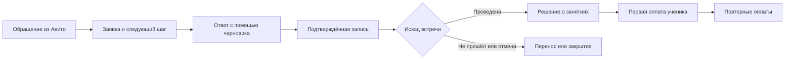

# ТЗ Cantor: первая рабочая версия сервиса

Редакция: 16.11.2026. Статус: рабочий проект требований для согласования.

**Основание:** [полный документ владельца](https://drive.google.com/file/d/1VwLj9B56S5FGLnq3ALuiIRMrkmBrOJ2z/view), [разбор и проверка кода](product-review.md). Концепция, шесть разделов, три формата обслуживания и целевая автоматизация взяты из источника. Детальные правила данных, приёмки и предложенное разделение релизов ниже — новая редакция, а не уже утверждённые бизнес-решения.

## 1. Цель и границы

Cantor помогает репетитору получать учеников с Авито и управлять путём от обращения до оплаты. Команда ведения работает в тех же карточках и видит те же результаты, что клиент, с дополнительными правами.

Первый рабочий релиз **R1 — пилот на текущих клиентах**: личный доступ, данные своего кабинета, очередь обращений, помощь с ответом, запись, исход диагностики, учёт оплаты. Система должна сохранять всю эту цепочку на сервере и объяснять цифры дашборда.

Следующий релиз **R2 — самостоятельное подключение и платный запуск**: проверенный OAuth Авито, импорт, тарифы и права модулей, онбординг без помощи разработчика; клиентские операции с объявлениями и ставками после проверки интеграций.

**R3 — контролируемая автоматизация**: отправка сообщений, календарная интеграция, напоминания и отдельные режимы автопилота. Состав R3 из полного ТЗ сохраняется в бэклоге; его наличие не требуется выдавать за готовность R1.

В R1 не входят: массовая генерация и публикация объявлений, самостоятельная закупка продвижения, автоответы 24/7, автоматические рассылки/скидки, звонки с расшифровкой, автоматические отзывы/жалобы, платёжный эквайринг Cantor, миграция всех внутренних инструментов агентства.

Это предложение очередности, которое сокращает путь к проверке основной гипотезы. Полный объём источника не отменяется.

## 2. Пользователи, права, ответственность

| Роль | Что делает | Ограничение |
| --- | --- | --- |
| Владелец клиентского пространства | Подключает кабинет, задаёт сведения и окна, ведёт обращения, фиксирует диагностики и оплаты | Только свои данные; управление участниками и тарифом — у владельца |
| Назначенный специалист/куратор | Работает с разрешёнными клиентами, отвечает за следующий шаг, оставляет рекомендации | Нет доступа к другим клиентам и глобальным ключам моделей; отзыв назначения прекращает доступ |
| Администратор платформы | Управляет подключением, ролями, поддержкой и доступностью модулей | Административные действия журналируются; отдельный интерфейс от клиентского кабинета |
| ИИ-помощник | Предлагает текст, следующий шаг и предварительный этап | В R1 не отправляет сообщения и не подтверждает запись или оплату |

Пространство — граница владения данными. В R1 один рабочий кабинет Авито на пространство; дальнейшее расширение на несколько кабинетов не должно менять идентификаторы заявок и учеников. Один пользователь может состоять в нескольких пространствах. Привязку действующего кабинета к пространству выполняет администратор после проверки владельца; произвольный `accountId` от клиента не даёт доступа.

Вход в Cantor и разрешение доступа к Авито — разные операции. Подключение Авито не заменяет проверку прав на пространство.

## 3. Первый запуск

### 3.1. Пилот R1

1. Администратор создаёт пространство, назначает владельца и при необходимости специалиста, привязывает существующий кабинет.
2. Владелец входит по личному приглашению и видит название своего кабинета. Общий пароль дашборда ему не выдаётся.
3. Заполняет предмет, классы, формат, длительность/цену занятий, предложение диагностики, часовой пояс, контакты и правила общения.
4. Задаёт свободные окна. Обязательные поля для черновиков — факты о преподавателе и условия; без них ИИ задаёт уточнения человеку.
5. Синхронизация показывает состояние каждого источника и доступную глубину истории. Клиент видит реальные данные либо понятное состояние ожидания/ошибки.
6. Первая рекомендация открывает конкретный объект с нужным действием. Если обращений нет, предлагается подготовить профиль и окна, а не показываются вымышленные лиды.

### 3.2. Самостоятельный запуск R2

Регистрация → разрешение доступа Авито → проверка полученного кабинета/прав → импорт → анкета и окна → первая полезная задача → выбор платного тарифа после триала.

OAuth сначала проходит техническую проверку: права приложения, разрешения клиента, получение профиля, обновление и отзыв токена. До этого «кнопка подключения без ключей» — требование, а не реализованный факт. При отказе в разрешении пользователь возвращается в мастер с объяснением и может повторить шаг без нового пространства.

Импорт существующего фида и объявлений, созданных вручную, — разные сценарии. Сервис не обещает восстановить отсутствующие тексты/фото из статистического API. Смена источника автозагрузки требует просмотра последствий; существующий фид нельзя молча перезаписать.

Предложение по триалу: 14 календарных дней с первой успешной синхронизации. До решения владельца платёжная логика не реализуется как утверждённая. Время «15 минут» проверяется замерами на пилоте; длительность обработки источников показывается отдельно.

## 4. Основной рабочий сценарий

Отказ, нецелевое обращение и переход в другой мессенджер фиксируются отдельно и не удаляют историю. Ученик может оплатить без диагностики; такая продажа допустима, но не создаёт фиктивную проведённую встречу.

В R1 преподаватель копирует черновик и отправляет его в Авито. Копирование и одобрение черновика не считаются отправкой. Ответ подтверждается новым исходящим сообщением из синхронизации; временная ручная отметка явно обозначается и затем сверяется с источником.

## 5. Требования к шести разделам

### 5.1. Дашборд

- Период: сегодня, 7 дней, текущий месяц, произвольные даты; часовой пояс указан. Период передаётся в аналитику при переходе.
- Верхний уровень: расходы на Авито, новые обращения, проведённые диагностики, новые оплатившие ученики, доступные показатели стоимости. Выручка и расходы имеют подписи состава.
- Две связанные области: статистика продвижения и CRM-путь людей. Не соединять их ложной сквозной конверсией при отсутствии идентификации.
- Три приоритетных действия и доступ ко всем остальным. Каждое содержит факт, источник, объект, срок/время ожидания, ответственного и целевое действие.
- Здоровье подключения: когда обновились данные, что не загрузилось, где требуется доступ или действие в Авито.
- Если данных нет, показать причину. Ноль — только достоверно полученное нулевое значение. Деморежим отделён от рабочего и явно подписан.

### 5.2. Аналитика

- Срезы по периоду, объявлению и городу только при наличии соответствующих исходных данных. Город объявления не равен географии каждого обратившегося.
- Показатели Авито: показы, просмотры, контакты, избранное, расходы — с названиями метрик исходного API и единицами. Отсутствующие поля показываются как недоступные.
- CRM: новые заявки, записанные, проведённые диагностики, отмены/неявки, новые ученики, оплаты, возвраты, неатрибутированные результаты.
- Для каждого числа доступно объяснение расчёта; для CRM — список объектов, из которых оно получено.
- 10–12% просмотра в контакт — ориентир из методики источника, не гарантия площадки. Вывод «ниже ориентира» показывает размер выборки и период. Минимальная выборка для рекомендаций — отдельная настраиваемая политика, до её выбора вывод считается наблюдением.
- Конверсии людей считаются по когорте поступления заявок с датой среза; текущая активность периода показывается отдельно. Заявка октября с оплатой ноября не становится новой заявкой ноября.
- До появления достаточной выборки не показывать «потери в рублях» и сравнение с нишей как измеренный факт.

### 5.3. Мои объявления

R1: список доступных объявлений, ID, реальный статус, город, показатели за выбранный период, ошибки источника и ссылка в Авито. Из проблемного объекта можно перейти к рекомендации и ответственному.

R2: мастер «модель → текст → фото → города → предпросмотр → публикация», импорт управляемого фида, журнал версий и отчёт выгрузки. Предварительная проверка полей идёт по актуальным требованиям категории Авито. Десять фото — ориентир контента; обязательность конкретных слотов требует отдельного решения, а не определяется произвольным названием файла.

Публикация — асинхронная операция: «подготовлено», «отправлено», «обрабатывается», «размещено», «отклонено», «ошибка». Запись фида не равна успешной публикации. Повтор операции не создаёт копию объявления.

Ставки R2: до изменения показываются кабинет, объявления, текущие и предлагаемые значения, расписание, лимиты. После изменения различаются «сохранено», «в очереди», «применено», «ошибка». Прогноз не выдаётся за гарантированное место. Пользователь может остановить наш менеджер ставок; смысл остановки и возвращаемая ставка явно описаны.

### 5.4. Мои диалоги

- Представления «Чаты» и «Воронка» работают с одними заявками. Фильтры: ждут ответа, есть черновик, требуется человек, записаны, после диагностики, отказ/нецелевые.
- Карточка: участник, исходное объявление, история сообщений, текущий этап, ответственный, следующий шаг, задачи, записи, ученик и оплаты.
- Этап можно исправить вручную; сохраняются старое значение, новое, автор, время и причина. ИИ предлагает этап, не переписывает ручное решение молча.
- Черновик учитывает факты преподавателя, историю, правила общения и реальные окна. Нельзя выдумывать цену, скидку, результаты учеников, доступность или ссылку встречи.
- Действия: редактировать, скопировать, оценить, не отвечать, передать человеку. Ошибка генерации не блокирует ручную работу.
- При новом входящем сообщении черновик помечается устаревшим. Недоступное голосовое/вложение не трактуется как отсутствие важного содержания.
- «Записать» требует выбрать заявку, окно, длительность и участника. Запись, перенос, отмена и исход встречи — самостоятельные события.
- Первая оплата создаёт нового оплатившего ученика один раз. Следующие платежи увеличивают сумму, сохраняя прежнее число новых учеников.

### 5.5. База знаний

Разделить два типа информации: общая методика Cantor и факты конкретного преподавателя. Общий урок не подменяет персональный прайс, расписание и договорённости.

R1: редактируемая анкета/база фактов преподавателя, правила общения, сведения об источнике и обновлении; практические материалы со ссылкой из нужного сценария. Устаревшие и неподтверждённые факты не используются ИИ как достоверные.

R2: курсы, видео и прогресс. Чат по базе знаний и генерация материалов — отдельные возможности, зависящие от тарифа и квот.

### 5.6. Настройки

Три отдельные группы: профиль и участники Cantor; подключение и состояние Авито; подписка Cantor и состав модулей.

Подписка Авито, кошелёк/аванс Авито и оплата Cantor — разные сущности. Нельзя показывать их одним тарифом. При недоступном авансе не выводить расчёт «хватит на N дней» из кошелька другого типа. Цена размещения не фиксируется универсальными 100 ₽/день: существующее внутреннее правило нужно сверить с конкретным тарифом и составом расходов.

В R1 права на модули задаются администратором пилота, без имитации реального списания. В R2 перед оплатой видны итоговая цена, срок, состав, квоты, продление и условия возврата. Понижение тарифа сохраняет историю; порядок доступа к ней после окончания подписки требует решения владельца.

## 6. Модель данных и инварианты

Все сущности принадлежат `workspaceId`; права проверяются сервером на чтение и запись, включая фоновые задания и выгрузки. Имена используются для отображения, а не как ключи.

| Сущность | Минимальные поля/связи | Инвариант |
| --- | --- | --- |
| Membership | userId, workspaceId, role, status | Отзыв прав действует на сервере, а не только прячет меню |
| AvitoConnection | workspaceId, внешний userId, разрешения, статус, последний успешный sync | Секреты и токены доступны только серверной интеграции |
| Listing / ListingMetric | connectionId, внешний itemId, дата, город, метрики и источник | Повтор синхронизации обновляет запись по внешнему ключу |
| Lead / Conversation | leadId, внешний chatId, listingId либо неизвестный источник, этап, ответственный | Разные люди с одинаковым именем не объединяются; несколько заявок одного человека объединяются только явно |
| Message / Draft | внешний messageId, направление, время; версия истории и базы для черновика | Повтор события не дублирует сообщение; новый контекст делает черновик устаревшим |
| Student | studentId, leadId, имя участника, связь с плательщиком | Родитель и ученик не обязаны быть одним человеком |
| Appointment | leadId, startsAt, endsAt, timezone, status, результат, версия | Нельзя подтвердить пересекающиеся записи одного преподавателя |
| Payment | studentId, leadId при наличии, amountMinor, currency, paidAt, статус, ключ повтора | Повтор отправки не создаёт второй платёж; возврат связан с исходным платежом |
| Task | объект, тип, приоритет, dueAt, assigneeId, status, deduplicationKey | Одна причина не создаёт новую задачу на каждом обновлении |
| AuditEvent / IntegrationJob | актор, объект, операция, результат, временные метки, requestId | Можно восстановить, кто и что изменил; журнал не содержит секреты |

Оплаты — учёт реально полученных преподавателем денег, не банковский эквайринг. Сумма положительная, в минимальных денежных единицах, валюта обязательна. Исправление и возврат оставляют след, а не удаляют историю. Частичный возврат уменьшает чистую сумму; полный возврат убирает ученика из показателя действующих первых оплат, с объяснимым пересчётом. Историческое событие первой оплаты сохраняется для аудита.

Конкурентная запись двух людей в одно окно: один успешный результат, второму — конфликт и обновлённая доступность. Нужны транзакция/атомарная проверка или эквивалентная гарантия. Проверка только в браузере и обычная запись JSON без согласования этого не обеспечивают.

## 7. Словарь показателей

| Показатель | Расчёт | Ограничение |
| --- | --- | --- |
| Контакты Авито | Значение выбранной метрики API по объявлению и периоду | Даже дневные `uniqContacts` при суммировании не становятся уникальными людьми за месяц/все объявления |
| Новые заявки | Уникальные leadId, созданные за период | Не равны контактам API; часть звонков и переходов не сопоставлена |
| Проведённые диагностики | Встречи со статусом `completed` по фактическому времени проведения | Записан, отменён, не пришёл — не проведён |
| Новые оплатившие ученики | studentId с первой действующей оплатой в периоде | Повторные платежи не дают новых учеников |
| Получено оплат | Сумма платежей по paidAt | Отдельно сумма возвратов и чистые поступления |
| Цена контакта | Подтверждённые расходы Авито / контакты того же периода и охвата | Нет расходов или знаменатель 0 → «не рассчитано», не 0 ₽ |
| Расходы на нового ученика за период | Расходы Авито периода / новые ученики периода | Периодный показатель, не точная сквозная стоимость привлечения когорты |
| Конверсия заявки в диагностику | Уникальные заявки когорты с проведённой встречей / заявки когорты | Показывать дату среза; одна заявка с двумя встречами считается один раз |
| Конверсия диагностики в первую оплату | Заявки той же когорты с проведённой встречей и первой оплатой / заявки с проведённой встречей | Прямые продажи без диагностики показывать отдельно |

Расходы Авито разделяются по подтверждённым типам: продвижение, размещение и прочие услуги; состав `allSpending` проверяется, чтобы не прибавлять размещение дважды. Подписка Cantor показывается отдельно; «полная стоимость привлечения» имеет явную формулу распределения. Без данных о марже и длительности обучения не обещать достоверную окупаемость.

Сквозной отчёт связывает заявку с исходным объявлением при наличии внешней связи. Если её нет, результат остаётся в «источник не определён», без пропорционального распределения на объявления. Стоимость по когорте требует сопоставимого источника расходов и оговорённой методики атрибуции; пока его нет, доступен периодный показатель с честным названием.

Технически хранить время событий в UTC, отображать в часовом поясе пространства (по умолчанию Europe/Moscow). Границы отчётного дня формируются в этом поясе. Интервал отчёта на сервере полуоткрытый `[from, to)`; адаптер переводит его в правила дат конкретного API. Денежные единицы Авито переводятся явно в одном адаптере.

## 8. Очередь действий и правила

Предложение приоритета: потеря доступа/блокировка → ожидающий ответа человек → приближающаяся встреча → задача после диагностики → оптимизация объявления. При равном приоритете — ближайший срок и длительность ожидания.

Каждое правило имеет идентификатор, версию, основание и условие завершения. Задача по ответу закрывается подтверждённым исходящим сообщением, по диагностике — отмеченным исходом, по оплате — внесённой оплатой либо ручным исходом «не купил». Переход по ссылке задачу не закрывает. Счётчик раздела — число уникальных открытых задач, а не сумма повторяющихся симптомов.

Предлагаемые стартовые настройки пилота: ответ дольше 30 минут — предупреждение в рабочие часы; отсутствие ответа 24 часа — предложение одного повторного сообщения при допустимости диалога. Это настройки методики, не SLA Авито. Рабочие часы, отказы и уже отправленные напоминания учитываются.

Напоминания R1 — внутренние задачи, не сообщения покупателю. Целевая схема источника — за день и за час; правило 3 часа из PR не считать утверждённым. Просроченная встреча требует исхода, а не автоматической отметки «проведено».

## 9. Интеграции и серверный контракт

### 9.1. Повторное использование

Использовать существующие возможности Worker и Yandex-прокси как исходную инфраструктуру. Из `service-shell` можно сохранить компоненты и навигацию; адаптеры данных и предметная модель заменяют прямой импорт `sample` и localStorage. Сам факт наличия кода авторизации в шаблоне не решает права на кабинеты Worker.

| Контур сейчас | Повторное использование | Обязательная доработка |
| --- | --- | --- |
| `/api/avito/overview`, `/chats`, `/messages`, `/tariff` | Серверные функции чтения | Ограничить кабинетом клиента; не отдавать список всех кабинетов |
| `/api/dashboard/ai-sales/*` | История, черновики, обратная связь, база | Изолировать конфигурацию, задания и обучающие примеры по пространству; убрать персональные значения по умолчанию другого преподавателя |
| `/api/dashboard/mbids/*` | Механика ставок, очередь, метрики | Проверить полномочия на каждый кабинет/объект; не передавать глобальное состояние клиенту |
| `/api/dashboard/feeds*`, `/api/avito/autoload` | Фиды и отчёты | Связать с правами пространства и журналом публикации |
| Yandex-прокси | Транспорт, уже используемый командой | Проверить передачу пользовательского удостоверения, CORS, cookies/заголовков и всех новых маршрутов |

Текущий прокси пропускает `/api/dashboard/*`, а не произвольный `/api/avito/*`. Предложенное пространство маршрутов клиента — `/api/dashboard/service/*` с **собственной** проверкой личной сессии и прав; оно регистрируется раньше общего обработчика дашборда. Это новый контракт, пока не существующий API. Альтернатива требует явного изменения маршрутизации прокси.

### 9.2. Предлагаемые операции R1

| Операция | Результат |
| --- | --- |
| `GET /me`, `/bootstrap` | Пользователь, доступные пространства, выбранное пространство, разрешения и состояние источников |
| `GET /overview`, `/analytics` | Данные периода, состав метрик, степень полноты, временные метки источников |
| `GET /tasks`, `/leads`, `/leads/:id` | Очередь, фильтрованные заявки, конкретная карточка и история |
| `POST /leads/:id/stage`, `/leads/:id/drafts` | Версионированная смена этапа или асинхронное задание генерации |
| `GET /availability`; `POST /appointments`, `/appointments/:id/reschedule`, `/appointments/:id/outcome` | Доступность, атомарная запись, перенос, отмена или исход |
| `GET /payments`; `POST /payments`, `/payments/:id/refunds` | Учёт платежей и возвратов с ключом повторной операции |
| `GET /knowledge`; `PUT /knowledge` | Факты преподавателя и новая версия базы |
| `GET /jobs/:id`; `POST /sync` | Статус своей фоновой операции; явный запуск синхронизации с ограничением частоты |

Пути в таблице относительны к `/api/dashboard/service`. Каждая операция выбирает пространство из проверенного контекста, а не доверяет присланному клиентом accountId. Для намеренно выбранного workspaceId сервер проверяет членство.

Ответы содержат `requestId`, `data` либо структурированную ошибку; для данных — `source`, `syncedAt`, `status` (`ready`, `partial`, `stale`, `unavailable`) по источнику. Для записей — `version`, для заданий — `jobId` и состояние. Нет сессии → 401; нет прав → 403 либо единообразный 404 для чужого объекта; конфликт записи/версии → 409; ошибка полей → 422; недоступность источника → отдельная ошибка интеграции с возможностью повтора.

### 9.3. Проверки до обещаний автоматизации

Таблица «есть в API» полного ТЗ — перечень заявленных возможностей, а не доказательство их доступности конкретному приложению Cantor. До реализации проверить актуальные методы, scopes, допуски приложения, тарифные ограничения, лимиты и реальные ответы для OAuth, messenger/webhook, календаря, autoload, статистики расходов, special-offers, отзывов и CPA-жалоб.

События вебхука и опроса дедуплицируются. Опрос остаётся способом сверки пропущенных событий; длительная генерация/синхронизация не держит HTTP-запрос открытым до таймаута. Повторы чтения допустимы с задержкой; внешние записи требуют защиты от повторной отправки. Платформа не начинает диалог с новым покупателем через несуществующий метод.

R3-автоответ включается отдельно по кабинету после ручного пилота. Состояния: выключен, черновики, разрешена автоматическая отправка, приостановлен. Перед отправкой перепроверяются версия истории, актуальность окна, разрешённый режим и отсутствие ответа человека. При неизвестном факте/ошибке задача передаётся человеку. Событие «внешняя отправка подтверждена» отличается от «команда принята».

## 10. Надёжность, доступ и интерфейс

- Статистика и операционные данные хранятся на сервере. localStorage допустим для предпочтений интерфейса и отдельного демо, не для подтверждённых оплат/записей.
- Секреты Авито, общий пароль агентства и глобальные ключи моделей не попадают в клиентский код, URL, логи и ответы API. Клиентские объекты нельзя получать подбором ID.
- Не создавать новую транзакционную CRM обычным перезаписыванием общей KV-записи без механизма конфликтов. Перед реализацией выбрать и документировать серверное хранилище и способ атомарных операций; не переносить инфраструктуру автоматически вслед за шаблоном Grok.
- Частичная ошибка не стирает последние успешные данные. Старые данные подписаны; повтор синхронизации не создаёт новые заявки и оплаты.
- Состояния каждого экрана: загрузка, данные, пусто, частично, ошибка, нет доступа, отключённый модуль. Текст сообщает следующее доступное действие.
- Ширины проверки: 390 и 1440 px, клавиатурный доступ, видимый фокус, подписи полей, ошибки рядом с полем, статус не только цветом. Мобильные чаты открывают одну рабочую область; таблицы имеют собственный скролл, страница не расползается.
- Начальная цель пилота: обзор из сохранённого состояния до 2 секунд на согласованном тестовом наборе; внешняя синхронизация показывает прогресс отдельно. Объём набора и частота обновления фиксируются перед нагрузочной проверкой.
- Поддержка видит ошибки по requestId без доступа к чужим данным по умолчанию. Резервирование и проверка восстановления обязательны до платного запуска; политика хранения переписок и удаления пространства согласуется до R2.

## 11. Критерии приёмки R1

| ID | Сценарий | Проверяемый результат |
| --- | --- | --- |
| AC-01 | Два клиента и назначенный одному специалист | Через UI и прямой запрос клиент/специалист не читают чужие заявки, задания, платежи и кабинет |
| AC-02 | Первое подключение, нулевая статистика, ошибка Авито | Три разных состояния; демоданные не подмешиваются в рабочие |
| AC-03 | Одно сообщение пришло через опрос и повторно через событие | Одно сообщение и одна заявка; история не удваивается |
| AC-04 | Преподаватель скопировал черновик | Отправка не отмечена; задача закрывается только после подтверждения либо явного ручного исхода |
| AC-05 | После генерации пришло новое сообщение | Старый черновик явно устарел; подтверждение записи не выполняется из старого контекста |
| AC-06 | Два оператора одновременно бронируют пересекающиеся окна | Одна подтверждённая запись, второму понятный конфликт; после перезагрузки результат тот же |
| AC-07 | Встречу перенесли, затем отметили неявку | Старое окно освобождено; встреча не попала в проведённые; история сохранена |
| AC-08 | Одному ученику внесли две оплаты и повторили первый запрос | Две оплаты, один новый ученик, без третьего платежа от повтора |
| AC-09 | Первый платёж исправлен или полностью возвращён | Чистая сумма и показатель действующих новых оплат пересчитаны по правилам; исправление объясняется историей |
| AC-10 | Заявка октября оплачена в ноябре | В ноябре есть оплата, но нет новой заявки; когортный отчёт сохраняет октябрьское происхождение |
| AC-11 | Продажа без диагностики; результат без объявления | Нет выдуманной встречи; неизвестный источник не разнесён по объявлениям |
| AC-12 | Нет расходов, 0 контактов либо частично доступный источник | «Не рассчитано»/«нет данных» вместо ложного нуля и деления на ноль |
| AC-13 | Переход из рекомендации и последующее завершение задачи | Открыт конкретный объект; счётчики на всех экранах согласованы и не закрылись от одного клика |
| AC-14 | Перезагрузка и вход с другого устройства | Платежи, записи, этапы и задачи совпадают с серверным состоянием |
| AC-15 | Проверка 390/1440 px и клавиатуры | Основной путь доступен; фокус, ошибки полей и мобильный переход назад работают |

Необходимые проверки: модульные тесты расчётов и переходов; интеграционные тесты прав, повторов и конфликтов; браузерный проход основного сценария; отдельная проверка адаптеров на разрешённом тестовом кабинете. Не отправлять покупателям сообщения и не менять ставки ради проверки без специально разрешённого сценария.

## 12. План реализации и точки готовности

| Пакет | Результат | Зависимость / выход |
| --- | --- | --- |
| P0. Проверка интеграций и доставки | Карта источников/прав/свежести, выбранное хранилище, проверенная схема preview и будущего deploy | Не обещаем совместимость Vercel-сборки с rsync-хостингом без проверки |
| P1. Клиентское пространство | Личная сессия, приглашения, роли, привязка существующего кабинета | AC-01; только после этого подключать реальные клиентские данные |
| P2. Вертикаль обращения | Импорт сообщения → карточка → черновик → подтверждённый внешний ответ | AC-02–05; одна реальная задача вместо шести новых страниц |
| P3. Диагностика и оплата | Окна, атомарная запись, исход, studentId, платежи и возвраты | AC-06–11, AC-14 |
| P4. Обзор и работа команды | Дашборд, аналитика, очередь, ответственные, глубокие ссылки | AC-12–15; каждое число объяснимо |
| P5. Пилот и решение о R2 | Проверка без помощи разработчика, замеры поддержки и результата | Согласованный набор кабинетов и период; исправлены блокирующие ошибки |
| P6. Самостоятельное подключение/тарифы | OAuth, онбординг, условия подписки, модули, возвраты, операции объявлений/ставок | Решения по коммерции и интеграционные проверки |
| P7. Автоматизация | Отправка, вебхуки, календарь, напоминания; затем отдельные автопилоты | Контроль внешних действий, измеримые лимиты и остановка |

Релизы выкладываются отдельно от `main` до проверки схемы размещения: текущий workflow копирует репозиторий целиком. Успешный TypeScript build оболочки не является подтверждением её запуска на хостинге агентства. Мерж и публикация — отдельные действия после готового результата.

Из полного ТЗ в последующий бэклог также сохраняются: звонки и расшифровки, голосовые, тесты контента, рассылки, отзывы, жалобы на спам, генерация профиля, месячная стратегия и сезонный режим. Каждая функция получает отдельный сценарий, ограничения API, бюджет, измерение результата и приёмку до включения.

## 13. Проверка ценности пилота

Предложение: выбрать 3–5 текущих кабинетов с достаточным потоком обращений и провести наблюдение не менее двух недель; размеры и срок согласовать по реальному потоку.

Измерять: долю успешно подключённых кабинетов; время до первой полезной задачи; время ответа в рабочие часы; долю заявок с подтверждённой записью; явку; первые оплаты; минуты работы команды на кабинет в неделю; долю принятых/исправленных черновиков; полноту учёта исходов; стоимость моделей и поддержки.

Активация для R1: пройден основной сценарий на реальной заявке, включая подтверждённую запись. Это предложенное определение, не обещание получить ученика за время триала. Сравнение с периодом до пилота учитывает поток, сезон и состав объявлений; малую выборку не выдавать за доказанный рост конверсии.

Выход из пилота: нет нарушений изоляции/потерь записей, основной сценарий проходит без разработчика, известна стоимость обслуживания и понятны причины ручного вмешательства. Коммерческие пороги конверсии и маржинальности определяет владелец по полученным данным.

## 14. Решения владельца до платного запуска

1. Утвердить предложенную границу R1 и последовательность R2/R3; кто отвечает за незакрытые диалоги на каждом тарифе и в какие часы.
2. Зафиксировать цены/квоты, состав базовой аналитики и сквозного отчёта, объём куратора. Уточнить разницу между сопровождением и работой под ключ.
3. Свести триал, дату начала оплаты, автопродление, паузу и возвраты; отдельно описать годовой ранний доступ и состав настройки.
4. Определить разрешённые режимы внешних действий: сообщения, ставки, публикация, рассылки. Утвердить роль человека и лимиты каждого режима.
5. Выбрать правило напоминаний и календарь, политику цены в диалоге, рабочие часы, правила закрытия нецелевых заявок.
6. Обновить финмодель с полной себестоимостью, нагрузкой поддержки и несколькими сценариями. Не обещать увеличение ёмкости специалиста вдвое до замера.

Эти вопросы не блокируют документирование, проверку интеграций и реализацию изолированного клиентского контура. До их решения нельзя считать спорные коммерческие условия согласованными.
